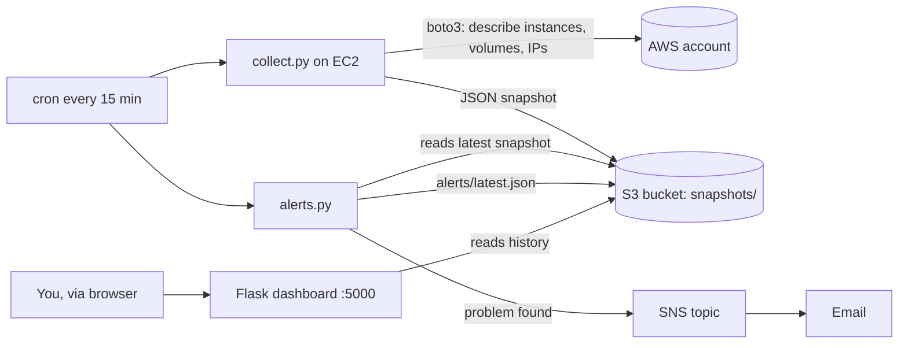
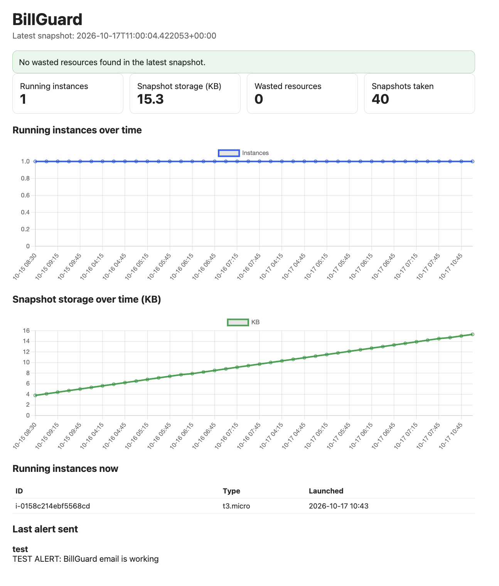

# BillGuard: AWS Free-Tier Bill Guard

A small monitoring tool that watches an AWS account for wasted or runaway resources, keeps a usage history in S3, emails an alert when something looks wrong, and shows everything on a live dashboard.

Built for a cloud computing course using EC2 and S3 (plus SNS), deployed in AWS Learner Lab.

## Problem

Students often get surprise AWS bills from things they forgot about: instances left running, unattached EBS volumes, unused Elastic IPs. BillGuard finds these early and tells you.

## Architecture



| Component | Role |
|---|---|
| EC2 (t3.micro) | Runs the collector, alert check and dashboard |
| S3 | Stores a timestamped JSON snapshot per run (the history) and the last alert |
| SNS | Sends the alert email |
| IAM role (LabRole via instance profile) | Gives the server access with no keys in code |
| Security group | SSH only from the EC2 Instance Connect range; dashboard port 5000 limited by source address |

## What it checks

- Running EC2 instances (count and type)
- Unattached EBS volumes
- Unused Elastic IPs
- Size of the snapshot history in S3

Limits live in the `CONFIG` dict in `alerts.py`. An alert fires at 80% of a limit, or whenever a wasted resource exists. Identical alerts are not re-sent.

## Screenshots



## Files

- `collect.py`: gathers usage and writes `snapshots/<timestamp>.json` to S3
- `alerts.py`: compares the latest snapshot to the limits and sends alerts (`python3 alerts.py test` sends a test email)
- `app.py`: Flask dashboard with charts, a wasted-resources banner and the last alert, protected by a password login (HTTP basic auth, user `admin`, password from the `BILLGUARD_PASSWORD` environment variable)

## Setup

1. Create an S3 bucket and set `BUCKET` in all three scripts.
2. Launch an EC2 instance (Amazon Linux 2023) with an instance profile that can read EC2 metadata, use S3 and publish to SNS.
3. Create a Standard SNS topic, subscribe and confirm your email, and put the topic ARN in `alerts.py` (replace `YOUR_ACCOUNT_ID`).
4. On the instance:
```
   sudo dnf install -y python3-pip cronie
   sudo systemctl enable --now crond
   pip3 install --user -r requirements.txt gunicorn
```
5. Schedule the collector and alert check:
```
   */15 * * * * cd /home/ec2-user && python3 collect.py >> billguard.log 2>&1 && python3 alerts.py >> billguard.log 2>&1
```
6. Store the dashboard password in a private file that is never committed:
```
   echo "BILLGUARD_PASSWORD=YourPasswordHere" > /home/ec2-user/.billguard.env
   chmod 600 /home/ec2-user/.billguard.env
```
7. Run the dashboard as a service. Create `/etc/systemd/system/billguard.service`:
```
   [Unit]
   Description=BillGuard dashboard
   After=network.target

   [Service]
   User=ec2-user
   WorkingDirectory=/home/ec2-user
   EnvironmentFile=/home/ec2-user/.billguard.env
   ExecStart=/home/ec2-user/.local/bin/gunicorn -b 0.0.0.0:5000 app:app
   Restart=always

   [Install]
   WantedBy=multi-user.target
```
   then run `sudo systemctl daemon-reload && sudo systemctl enable --now billguard`.
8. Open port 5000 in the security group and visit `http://INSTANCE_IP:5000`. Log in as `admin` with your password.

## Security notes

- No access keys in the code: the instance profile provides credentials.
- The S3 bucket blocks all public access.
- The dashboard is protected by a password login. The password lives in a private file on the server (`.billguard.env`, permissions 600) and is not in the repository.
- SSH is allowed only from the EC2 Instance Connect address range, so the browser Connect button works from any network.
- The dashboard is served by gunicorn under systemd, which restarts it after a crash or reboot.

## Limitations

- Learner Lab sessions end after a few hours, so scheduled runs pause between sessions. History continues in S3 when the lab restarts.
- The instance's public IP changes after every restart.
- Cost Explorer is not available in Learner Lab, so spend is not tracked; only resource usage is.
- The dashboard uses plain HTTP, so the login password is not encrypted in transit. Use a password you do not use elsewhere.

## Future work

- HTTPS for the dashboard (needs a domain name and a certificate)
- Cost Explorer integration and spend projection in a standard AWS account
- Optional auto-stop of idle instances
- S3 lifecycle rule to expire old snapshots